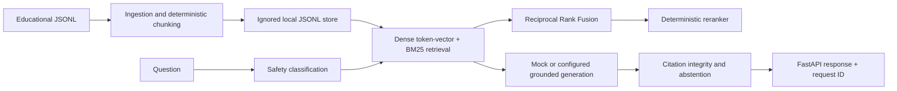

# Educational Medical RAG

An offline-first, evidence-retrieval API that demonstrates document ingestion, lexical and deterministic dense retrieval, hybrid rank fusion, citation checks, safe abstention, and reproducible evaluation. It is designed as a portfolio engineering project; it is not clinical software and its small synthetic corpus is not medical guidance.

## Problem and safety boundary

General-purpose generation can produce unsupported statements and citations. This project retrieves from a small corpus and returns source-linked excerpts, while abstaining when retrieval has no supporting evidence. It does not diagnose, prescribe, calculate doses, recommend treatment, triage, or respond to emergencies. Emergency-like questions receive only a recommendation to contact local emergency services or a qualified professional. Answers include an educational disclaimer. Nothing here is clinically validated.

RAG makes retrieved source material inspectable and replaceable without retraining model weights. The default implementation uses a deterministic mock generator and synthetic corpus, so it needs no model download, paid API, or network. Optional OpenAI-compatible and Gemini adapters are available when mock mode is disabled and the selected provider key is configured.

## Architecture



Request flow: validate input; apply safety rules; retrieve with the selected mode; rerank if requested; generate using the configured provider; verify cited chunk IDs; return citations, disclaimer, safety classification, and timing metadata. Retrieved text is treated as untrusted data.

## Structure and design choices

- `app/api`, `app/schemas`, and `app/services` separate HTTP, validation, and orchestration.
- `app/retrieval` includes BM25, token-vector cosine fallback, RRF, and hybrid composition.
- `data/sample` contains three short synthetic educational entries. `data/local` is ignored and holds locally ingested chunks.
- `evaluation` provides a small synthetic question set and deterministic ranking/abstention proxies.
- `tests` contains unit and API integration coverage.
- `docs` describes architecture, security, evaluation, decisions, and interview talking points.

BM25 helps exact terms; rank fusion combines lexical and token-vector rankings without assuming scores share a scale. The lightweight reranker is deterministic and inexpensive, but is not a cross-encoder. The local store is JSONL; Qdrant is not required or currently wired into the application.

## Technology stack

Python 3.11+, FastAPI, Pydantic v2, HTTPX for optional provider adapters, local JSONL persistence, deterministic BM25/token-vector retrieval, pytest with coverage, Ruff, mypy, Docker, and GitHub Actions.

## Setup

Requires Python 3.11 or newer. All configuration comes from environment variables; `.env.example` documents names and contains blanks/placeholders only. `.env` is ignored.

```bash
python -m venv .venv
# Windows PowerShell: .venv\Scripts\Activate.ps1
# macOS/Linux: source .venv/bin/activate
python -m pip install -r requirements.txt
```

For offline local development, set `MOCK_MODE=true` (the default) and run `uvicorn app.main:app --reload`. If you use a local `.env` file, pass `--env-file .env`; never commit that file. OpenAPI docs are at `/docs`; readiness is `/ready`.

### Environment and real-provider boundary

Available variables include `APP_ENV`, `MOCK_MODE`, `LOG_LEVEL`, `HOST`, `PORT`, `LLM_PROVIDER`, `LLM_MODEL`, `OPENAI_API_KEY`, `GEMINI_API_KEY`, `EMBEDDING_PROVIDER`, `EMBEDDING_MODEL`, `VECTOR_DB_URL`, `VECTOR_COLLECTION`, `QDRANT_API_KEY`, `TOP_K_DENSE`, `TOP_K_BM25`, `TOP_K_RERANK`, `MIN_RELEVANCE_SCORE`, `MAX_CONTEXT_CHARS`, `INGESTION_API_KEY`, `CHUNK_SIZE`, `CHUNK_OVERLAP`, `RATE_LIMIT_REQUESTS`, and `RATE_LIMIT_WINDOW_SECONDS`. The rate-limit values are reserved placeholders; no limiter is enforced. OpenAI-compatible chat completion and Gemini JSON-mode adapters are available when `MOCK_MODE=false`, `LLM_PROVIDER` selects one, and its key variable is configured. CI/tests/evaluation stay in mock mode and make no provider calls. Never put credential values in source, docs, logs, test data, or container images.

### API examples

```bash
curl http://127.0.0.1:8000/health
curl http://127.0.0.1:8000/ready
curl -X POST http://127.0.0.1:8000/api/v1/ask -H "Content-Type: application/json" -d '{"question":"What does hydration mean?","retrieval_mode":"hybrid"}'
```

Supported response shape: `answer`, `citations` (stable source IDs and short excerpts), `disclaimer`, `safety`, and `observability`. Unsupported questions return an explicit insufficient-evidence answer and no citations. Emergency-like questions return a high-level urgent-care recommendation.

Simplified supported response example (timing fields omitted):

```json
{
  "answer": "Available educational evidence: Hydration refers to having enough water available for normal body functions...",
  "citations": [{"source_id": "hydration-001", "title": "Basic health concepts: hydration", "source": "Synthetic educational sample", "section": "Hydration", "excerpt": "Hydration refers to having enough water available..."}],
  "disclaimer": "Educational information only; not for diagnosis, treatment, or emergencies. Consult a qualified health professional.",
  "safety": {"category": "factual", "emergency": false, "abstained": false, "citation_support": 1.0}
}
```

Simplified insufficient-evidence response example (timing fields omitted):

```json
{
  "answer": "I could not find sufficient supporting evidence in the available educational corpus to answer this question.",
  "citations": [],
  "disclaimer": "Educational information only; not for diagnosis, treatment, or emergencies. Consult a qualified health professional.",
  "safety": {"category": "unsupported", "emergency": false, "abstained": true, "citation_support": 0.0}
}
```

Ingestion accepts educational JSON payloads at `POST /api/v1/documents/ingest`; it requires `X-API-Key` only when `INGESTION_API_KEY` is configured. Files are written to ignored `data/local/documents.jsonl`. For batch ingestion, use `python -m scripts.ingest_documents data/sample/sample_medical_corpus.jsonl --dry-run` then omit `--dry-run` to write chunks. Review source rights and privacy before ingestion.

## Quality and evaluation

```bash
make setup
make format-check
make lint
make typecheck
make test
make evaluate
```

Evaluation compares `dense`, `bm25`, `hybrid`, and `hybrid_rerank`. Run `MOCK_MODE=true python -m evaluation.run_evaluation`; the generated report is `evaluation/reports/mock-evaluation.json`. Metrics are generated locally and are not pre-filled claims. Citation support and groundedness are integrity proxies, not clinical or LLM-as-judge evaluations. Synthetic set size limits interpretation.

## Docker

```bash
docker compose up --build
docker compose down
```

The container runs the local JSONL-backed API. Persistent ingestion data uses a named volume. Qdrant is not required; `VECTOR_DB_URL` is reserved for a future adapter and currently unused.

## Security and privacy

No authentication is provided for the question endpoint. Ingestion API-key protection is optional and intended only as a small local control. There is no distributed rate limiting. Questions and answers are not logged by default; request logs contain request ID, endpoint, status, and latency. Do not submit identifiable health data. See [docs/security.md](docs/security.md).

## Limitations and next steps

The corpus is synthetic and very small. Dense retrieval is a deterministic token-vector fallback, not semantic embeddings. Retrieval relevance and grounding checks do not establish medical correctness. Qdrant, production authentication, distributed rate limiting, and clinical validation are not included. Real provider adapters require credentials and network at runtime and are not tested against external services. Useful extensions include a rights-cleared public corpus, measured embedding adapter, cross-encoder reranker, and deployment hardening.

## Interview talking points

Discuss why retrieval gives inspectable evidence, how BM25 and dense-style ranking complement each other, why RRF combines rankings, how citation IDs are checked, and why safe abstention matters in a medical-information demo. Be clear that all provided evaluation data is synthetic and the implementation does not validate clinical accuracy. See [docs/interview-guide.md](docs/interview-guide.md).
