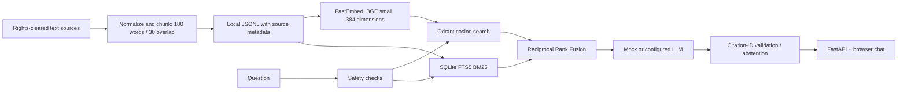

# MedGuide — Educational Medical RAG

MedGuide is a browser chat interface and FastAPI service that retrieves excerpts from supplied medical education text and returns evidence-linked educational responses. It is a learning/portfolio prototype, not a clinical service. It cannot diagnose, recommend treatment or doses, triage, or respond to emergencies.

## Current state (read before demo/deployment)

- The supplied workspace has **nine `.txt` extracts**, not PDFs. Their original page numbers and layout were not supplied, so citations show file/section/chunk rather than page. The ingestion audit reports **110,891 chunks** using 180-word windows with 30-word overlap. `Gastrology.txt` contains 67,528 replacement characters; the original missing characters cannot be reconstructed.
- Source texts and generated chunks/indexes are ignored by Git because the supplied texts contain publisher copyright notices and redistribution rights have not been confirmed. Your local VS Code folder keeps them; the public GitHub branch will contain code and docs, not those books or derived chunk text. Confirm Hack-A-Cure's data license before uploading or sending them to any hosted service.
- The full chunk file has been generated locally. Its **Qdrant vector and FTS5 keyword indexes have not been rebuilt/verified** yet. The app now reports not-ready and won't quietly fall back to the tiny sample corpus when the supplied books exist but the full index is absent. It cannot answer from all books until `/ready` reports ready.
- Default `MOCK_MODE=true` returns a deterministic evidence excerpt, not a natural-language LLM answer. For generated answers, configure a supported Gemini or OpenAI provider and a private API key. A provider can still hallucinate; citation checks validate source IDs, not medical truth.
- Signup/login and opt-in encrypted conversation history are prototype features. SQLite is for local, single-instance use; PostgreSQL can be selected with `DATABASE_URL`. This is not a production identity provider or medical-record system. Do not enter identifying health data.
- No public endpoint, RAGAS score, expert jury result, clinical validation, or measured improvement is claimed. The checked-in benchmark is synthetic and too small to represent medical quality.

## Problem statement and approach

Long textbooks are difficult to search conversationally, while unconstrained language models may produce unsupported explanations. MedGuide tests a retrieval-augmented generation (RAG) workflow: split approved source text into traceable passages, retrieve relevant passages using both semantic and exact-term search, combine their rankings, then answer from the retrieved evidence and expose citations. If the evidence is missing, the intended behavior is abstention. This makes sources inspectable; it does not establish clinical correctness.

## Architecture



At query time the API validates input, applies a limited deterministic safety layer, retrieves candidates, combines dense and lexical rankings with Reciprocal Rank Fusion, optionally reranks by token overlap, and builds a provider prompt from the evidence. The grounding layer rejects citation IDs that are not among the retrieved chunks. This is a provenance-integrity check, not a medical fact checker. See [architecture](docs/architecture.md), [security](docs/security.md), and [evaluation notes](docs/evaluation.md).

## Technology

Python 3.11+, FastAPI, Pydantic, FastEmbed (`BAAI/bge-small-en-v1.5`), Qdrant, SQLite FTS5/BM25, reciprocal rank fusion, optional Gemini/OpenAI-compatible generation, SQLite/PostgreSQL account storage, Fernet encryption for opted-in saved conversations, pytest, Ruff, Docker Compose, and optional RAGAS evaluation.

## Local setup (Windows PowerShell)

Copy the nine supplied `.txt` files into `data/raw/hack-a-cure/`. Keep the originals unchanged. From the repository root:

```powershell
py -3.12 -m venv .venv
.\.venv\Scripts\python.exe -m pip install -r requirements.txt
Copy-Item .env.example .env
.\.venv\Scripts\python.exe -c "from cryptography.fernet import Fernet; print(Fernet.generate_key().decode())"
```

Put the generated key in the ignored `.env` as `DATA_ENCRYPTION_KEY=...` if you want to enable history. Never paste API keys or encryption keys into chat, source code, README, or GitHub. Use `.venv`'s Python to run commands so dependencies install into the same environment.

Create the chunk file and audit, then build both indexes:

```powershell
.\.venv\Scripts\python.exe -m scripts.ingest_text_corpus
.\.venv\Scripts\python.exe -m scripts.index_vector_store --batch-size 64
```

The full build embeds over 110,000 chunks and may take a long time on a laptop. Keep the terminal open and watch its progress messages. If a run is interrupted, rerun without `--recreate`; it skips vector IDs already stored and rebuilds the keyword index. For full-scale indexing use a persistent Qdrant server/cloud cluster and adequate disk/RAM. `--recreate` deletes the selected Qdrant collection before rebuilding it, so use it only after changing the corpus/chunker or when you intentionally want a clean rebuild. The indexer compares exact chunk-ID sets, not only counts, and writes an ignored manifest only after vector and keyword indexes match. Check `http://127.0.0.1:8000/ready`; it must report `ready` and 110,891+ indexed chunks (the actual expected total includes the checked-in sample and any local ingested documents).

### Quick partial-corpus demo

If the full embedding pass is too heavy for your laptop, press **Ctrl+C** in the indexing terminal, then build a keyword index for the vectors already stored and mark that corpus coverage partial:

```powershell
.\.venv\Scripts\python.exe -m scripts.index_vector_store --finalize-partial
```

This does not create additional vectors. `/ready` reports the indexed and total chunk counts, and the website labels the index **Partial textbook index ready**. You can demo the UI and ask about material in the indexed subset, but it may miss other topics and must not be described as searching all nine textbooks. Resume full indexing later with the normal command above; the app should be stopped while the local Qdrant index is being modified.

Run the site:

```powershell
.\.venv\Scripts\python.exe -m uvicorn app.main:app --reload --env-file .env
```

Open `http://127.0.0.1:8000/`. `/docs` is the developer API explorer; `/health` only reports process health; `/ready` confirms both full indexes. Until readiness succeeds, the provided textbook corpus is unavailable to queries.

## Accounts, history, and database

Accounts use scrypt password hashing and opaque, hashed server-side session tokens in HttpOnly/SameSite cookies. History is off by default. Users may opt in; conversation JSON is encrypted with Fernet before storage, and turning history off deletes saved conversation rows. The UI can list and reopen saved conversations. SQLite works for local single-instance use. Set `DATABASE_URL=postgresql://...` for a managed PostgreSQL database; set `DATA_ENCRYPTION_KEY` independently and privately. Account creation currently has no email verification/password reset and this prototype has no distributed login throttling. Do not call it production-grade account/security infrastructure.

## Optional natural-language generation

Configure `.env` locally, or the hosting provider's secret settings:

```env
MOCK_MODE=false
LLM_PROVIDER=gemini
LLM_MODEL=gemini-2.0-flash
GEMINI_API_KEY=<private key>
```

Alternatively choose the supported OpenAI provider and set `OPENAI_API_KEY`. Do not commit `.env`. The real provider receives the question and retrieved text, so only use rights-cleared educational content and non-identifying questions. Provider names/model availability/cost can change; check the provider's current console/docs.

## API

```powershell
Invoke-RestMethod http://127.0.0.1:8000/health
Invoke-RestMethod http://127.0.0.1:8000/ready
Invoke-RestMethod -Method Post http://127.0.0.1:8000/api/v1/ask -ContentType 'application/json' -Body '{"question":"What does hydration mean?","retrieval_mode":"hybrid"}'
```

Key endpoints: `POST /api/v1/ask`; `POST /api/v1/documents/ingest`; `POST /api/v1/auth/signup`; `POST /api/v1/auth/login`; `GET/PATCH /api/v1/auth/history`; `GET /health`; `GET /ready`; `GET /docs`. The answer response includes answer, citations/excerpts, disclaimer, safety classification, and timing/retrieval metadata. Ingestion API-key checking is active when `INGESTION_API_KEY` is set.

## Evaluation and RAGAS

Run the deterministic synthetic retrieval checks:

```powershell
.\.venv\Scripts\python.exe -m evaluation.run_evaluation
```

Optional RAGAS judge evaluation needs `requirements-eval.txt`, a ready index, network, and a private Gemini API key (`GEMINI_API_KEY` or `GOOGLE_API_KEY`):

```powershell
.\.venv\Scripts\python.exe -m pip install -r requirements-eval.txt
.\.venv\Scripts\python.exe -m evaluation.run_ragas
```

It estimates faithfulness and context utilization. It does not establish answer correctness or clinical safety, and the synthetic cases are not a medical benchmark. A credible hackathon evaluation needs a rights-cleared held-out question set, reviewed expected answers/relevant passages, reproducible runs, RAGAS outputs, and independent jury review. Report actual results; do not invent scores. See [jury scorecard](evaluation/jury-scorecard.md).

## GitHub and deployment

GitHub stores source code; it does not run this FastAPI service by itself. The repository includes a Vercel Python entry point, but a useful deployment still needs a durable external Qdrant, PostgreSQL, embedding model availability, encrypted-history key, and LLM key (if generation is enabled). Vercel functions have read-only storage except temporary `/tmp`; local SQLite/Qdrant persistence and local textbook files do not become durable hosted services. The 110k-chunk index must be built and uploaded separately after confirming data rights. Configure secrets in the hosting dashboard; never commit them. A free Qdrant cluster is documented for prototyping with resource limits and inactivity behavior, not as a guarantee for production or sensitive health data. Do not advertise a deployed endpoint until `/ready` passes on the deployed URL.

For a portfolio/hackathon demo, Vercel plus managed Qdrant/PostgreSQL is possible after the data-license check and full index upload. For actual patient or identifiable health data, this prototype is not an appropriate service; privacy, security, clinical, regulatory, provider, and operations review is required.

## Interview preparation

See [the interview guide](docs/interview-guide.md) for the problem statement, architecture narrative, trade-offs, likely questions, honest project status, and a code walkthrough. Lead with the actual implementation and the known limits: nine text extracts, 180/30 word chunking, hybrid Qdrant + FTS5 retrieval, RRF, configurable generation, prototype accounts, and no verified RAGAS score or deployment yet.
