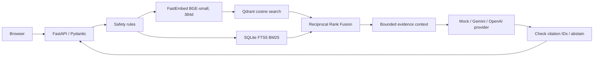

# Architecture and local data pipeline

## Request path



`app/main.py` creates the app, registers endpoint routers, serves `app/static/index.html`, initializes account storage, and adds request IDs plus logs that omit question text. The question route checks emergency, dosage/treatment, and prompt-injection patterns before retrieval. These deterministic checks are limited heuristics, not comprehensive medical safeguards. The API then validates the question, runs retrieval, sends retrieved excerpts to the selected generator, checks provenance IDs, and returns the answer, citations, disclaimer, safety state, and timing.

## Source files, chunking, and audit

The local source directory contains nine `.txt` extracts. No PDFs/page metadata were provided. Keep the original sources unchanged in `data/raw/hack-a-cure/`; Git ignores that directory because the extracts contain publisher copyright notices and rights for redistribution are unverified.

Run:

```powershell
python -m scripts.ingest_text_corpus
```

The script reads each UTF-8 file, normalizes Unicode and repeated spaces, preserves paragraph/newline boundaries, replaces U+FFFD characters with spaces, and emits overlapping windows of at most 180 words with 30 words of overlap. It records document ID, title, source filename, detected chapter/section label, chunk index, chunker version, content hash, and chunk ID. A SHA-256 digest makes IDs stable for the same source, chunk position, and chunker version. Outputs are local ignored files: `data/local/hack_a_cure_chunks.jsonl` and `data/local/corpus_audit.json`.

The current audit has 110,891 chunks over the nine input files. `Gastrology.txt` has 67,528 Unicode replacement characters; those source characters are already lost in the extract. There are no page numbers. These numbers are an ingestion audit, not a quality score. Word windows are a simple baseline; section-aware/token-aware boundaries should be tested against expert-reviewed retrieval labels.

## Embeddings and hybrid indexes

`BAAI/bge-small-en-v1.5` through FastEmbed creates 384-dimensional vectors. The first use downloads model files into its cache. Qdrant stores vectors plus the chunk payload. `QDRANT_URL=embedded` keeps a local single-process Qdrant store under `data/local/qdrant/`; a Qdrant HTTP URL uses a server or managed cluster.

SQLite FTS5 indexes titles/source/content and ranks exact terms with BM25. Hybrid search obtains dense and keyword candidate lists and combines ranks with Reciprocal Rank Fusion: `score(d) = sum(1 / (k + rank_i(d)))`. This avoids mixing unrelated raw similarity and BM25 scales. The optional final reranker is deterministic token overlap, not a learned cross-encoder.

Build the indexes after chunking:

```powershell
python -m scripts.index_vector_store --recreate --batch-size 64
```

The script embeds and upserts unique chunk IDs, rebuilds FTS5, checks both exact point counts, and writes `data/local/index_manifest.json` only after the counts agree. `--recreate` deletes the configured Qdrant collection; use it for a deliberate full rebuild. An incomplete build should not be used for queries. `/ready` verifies the manifest and both index counts. In development, if the supplied text corpus is present but its indexes are incomplete, question answering fails closed instead of switching to synthetic sample answers.

## Accounts and saved history

`app/services/account_service.py` supports SQLite for local use or PostgreSQL when `DATABASE_URL` is configured. Passwords use scrypt; session tokens are random and only their SHA-256 hashes are stored. Cookies are HttpOnly and SameSite strict, and secure outside development. Conversation history defaults off. If a user opts in and `DATA_ENCRYPTION_KEY` is configured, serialized question/answer content is encrypted with Fernet before persistence. Turning history off deletes saved conversation records. This is prototype account code: no email verification, password reset, distributed login rate limit, or formal privacy/security review.

## API and generation

- `GET /health`: process health and nonsecret generation-provider label.
- `GET /ready`: confirms that vector and FTS5 indexes match the local index manifest.
- `POST /api/v1/ask`: question answering with citations and safety metadata.
- `/api/v1/auth/*`: signup, login, logout, account, and optional history endpoints.
- `POST /api/v1/documents/ingest`: local ingestion endpoint; can require an API key.
- `GET /docs`: Swagger/OpenAPI explorer for developers; it is not the end-user app.
- `GET /`: browser chat UI.

Default mock generation is deterministic and returns evidence excerpts. To compose answers, configure a supported provider, model, and secret key, set `MOCK_MODE=false`, and restart. Questions and retrieved excerpts leave the machine when a hosted provider is used. The citation integrity check cannot prove entailment or clinical truth.

## Evaluation

`python -m evaluation.run_evaluation` compares retrieval against checked-in synthetic expected IDs using ranking metrics and abstention proxies. It is not RAGAS or a medical benchmark. `python -m evaluation.run_ragas` optionally asks Gemini through RAGAS to estimate faithfulness and context utilization. It requires both indexes, network, and a private API key. The judge sees questions, answers, and retrieved excerpts. Report no score until the runner has produced a result. Both judge-model metrics and a human rubric are needed; neither validates medical safety.

## Deployment

Local JSONL chunks and SQLite/Qdrant files are ignored and not part of Git. Deployment requires a rights-cleared corpus, a complete vector/keyword index, durable external Qdrant, durable PostgreSQL, secret configuration, and a real embedding/model strategy. The repository includes Vercel's Python entrypoint, but Vercel functions have ephemeral/read-only filesystem constraints (only `/tmp` scratch storage). The local SQLite and embedded Qdrant configuration is not suitable for a multi-instance hosted app. A remote index must be built and uploaded separately. Do not publish a working endpoint until deployment `/ready` succeeds and privacy/data rights are reviewed.
